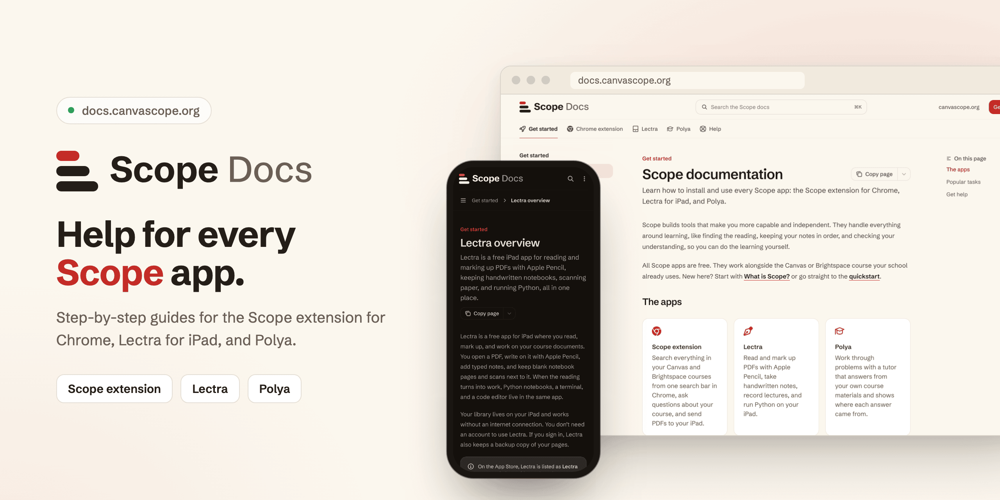
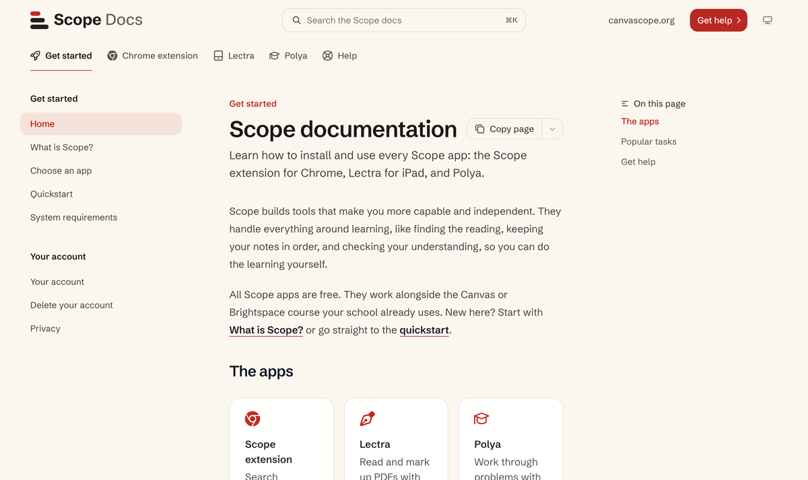
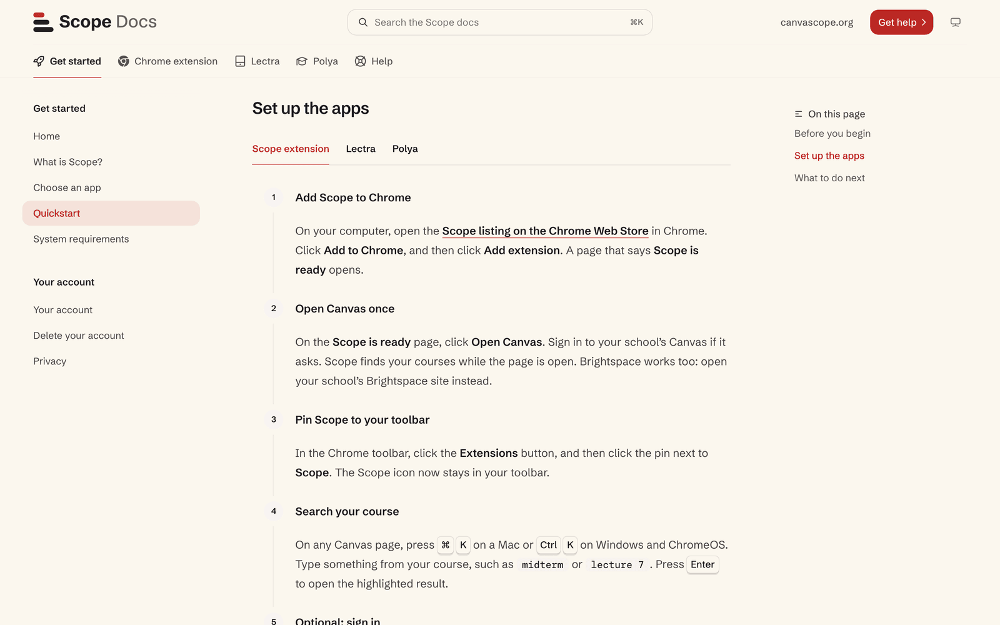
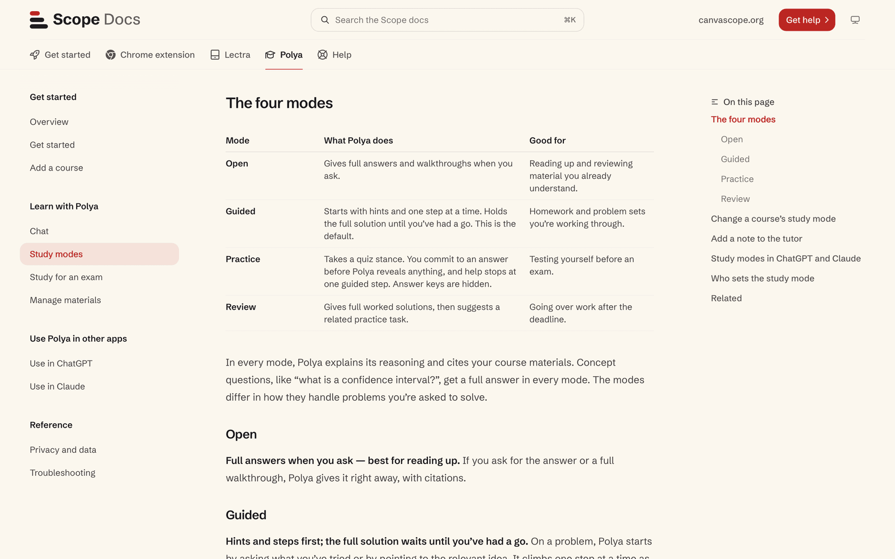
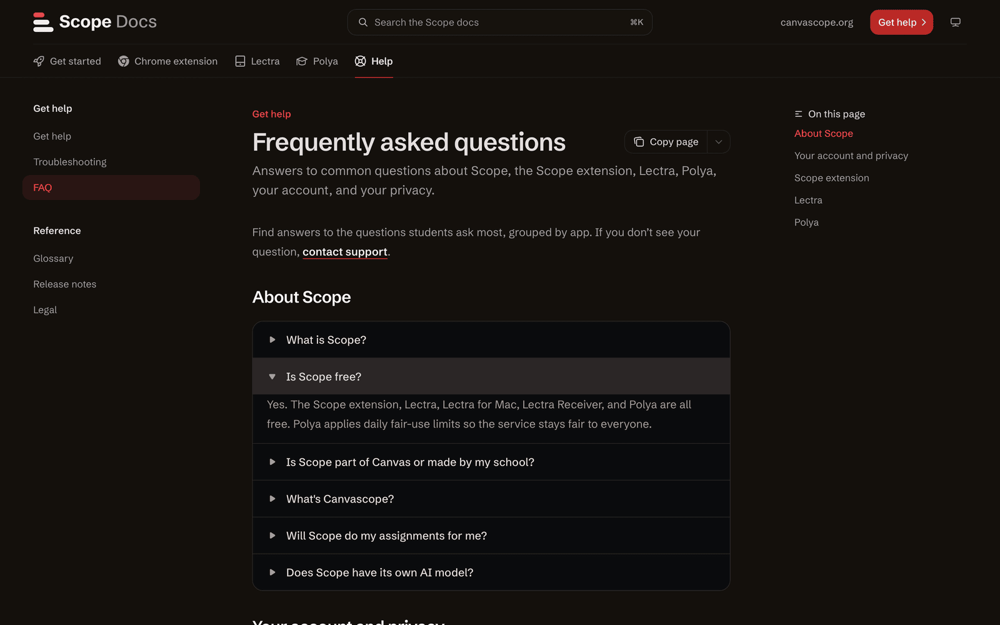
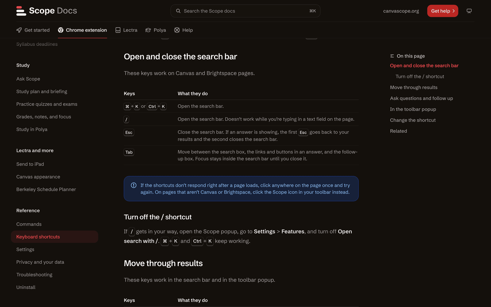
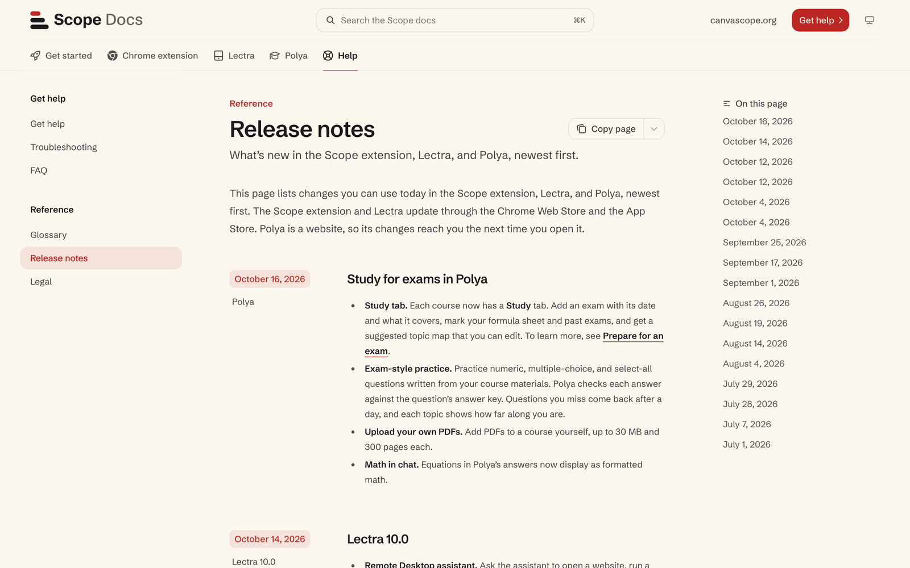
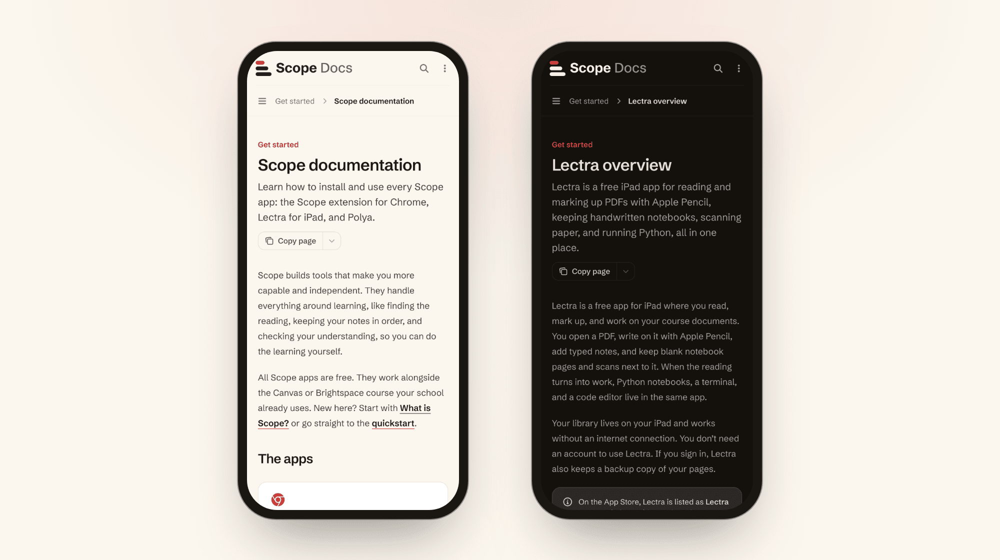

<p align="center">
  
</p>

<p align="center">
  <b>The help site for every Scope app.</b><br>
  Task-by-task guides for the Scope extension for Chrome, Lectra for iPad, and Polya, published at <a href="https://docs.canvascope.org">docs.canvascope.org</a>.
</p>

<p align="center">
  
  
  
  <a href="https://docs.canvascope.org"></a>
</p>

<p align="center">
  <a href="#tour">Tour</a> ·
  <a href="#whats-on-the-site">What's on the site</a> ·
  <a href="#preview-locally">Preview locally</a> ·
  <a href="#layout">Layout</a> ·
  <a href="#writing-rules">Writing rules</a> ·
  <a href="#deploy">Deploy</a>
</p>

> [!NOTE]
> Mintlify deploys the `main` branch of `hqscope/docs` to [docs.canvascope.org](https://docs.canvascope.org). Anything merged to `main` goes live for students, so run the [checks](#check-before-you-push) first.

## Why

The three Scope apps work on the same courses: the Chrome extension finds a reading and sends it to Lectra on the iPad, and Polya teaches from the same course materials. This site puts the help for all three in one place, organized by app and by task, so a student can look up how to do something without first knowing which app does it. Every page is written for the student, not for the engineer who built the feature.

## Tour

<p align="center">
  
</p>

<sub>Captured from the local preview (<code>npx mint dev</code>) on October 26, 2026. Each frame is the real page shown after clicking its tab in the top bar.</sub>

## What's on the site

The site has five tabs and 73 pages. A page appears in the sidebar only when [`docs.json`](docs.json) lists it under `navigation`.

| Tab | Pages | What it covers |
|---|---|---|
| **Get started** | 8 | What Scope is, choosing an app, the quickstart, system requirements, accounts, privacy |
| **Chrome extension** | 21 | Installing, connecting courses, search, due dates, Ask Scope, study tools, Send to Lectra, shortcuts |
| **Lectra** | 27 | Library, Apple Pencil markup, notebooks, scanning, recording lectures, Python and Jupyter, Git, Lectra for Mac, backups |
| **Polya** | 11 | Adding a course, chat with citations, study modes, exam practice, using Polya in ChatGPT and Claude |
| **Help** | 6 | Getting help, troubleshooting, FAQ, glossary, release notes, legal |

Pages are built from Mintlify's components, so each kind of content has one consistent shape.

<table>
  <tr>
    <td width="50%"></td>
    <td width="50%"></td>
  </tr>
  <tr>
    <td valign="top"><b>1. Steps for every task.</b> Procedures use numbered steps, and tabs split them by app. The quickstart sets up all three apps on one page.</td>
    <td valign="top"><b>2. Tables for comparisons.</b> When a choice depends on what you need, such as Polya's four study modes, a table lays the options side by side.</td>
  </tr>
  <tr>
    <td width="50%"></td>
    <td width="50%"></td>
  </tr>
  <tr>
    <td valign="top"><b>3. Questions that fold open.</b> The FAQ groups questions by app, and troubleshooting pages group problems by topic. Each answer opens in place. Here the site follows the system's dark mode.</td>
    <td valign="top"><b>4. Keys you can see.</b> Shortcuts render as keycaps, and limits sit in callouts next to the steps they affect.</td>
  </tr>
  <tr>
    <td width="50%"></td>
    <td width="50%"></td>
  </tr>
  <tr>
    <td valign="top"><b>5. Release notes by date.</b> Each update is labeled with its date and app, newest first, and the side column jumps to any date.</td>
    <td valign="top"><b>6. Readable on a phone.</b> The sidebar folds into a menu, so a student can follow the steps on a phone while the app is open on the computer.</td>
  </tr>
</table>

Every page also has a **Copy page** menu. It copies the page as Markdown, shows the Markdown, or opens the page in ChatGPT or Claude.

## Preview locally

You need Node.js 20 or later.

```bash
npx mint dev
```

The site opens at `http://localhost:3000` and reloads when you save a file. To use a different port, add `--port`, for example `npx mint dev --port 3333`.

Search works on the published site. In a local preview, it works only after you run `npx mint login`.

### Check before you push

Run both checks before you push:

```bash
npx mint validate       # build errors and warnings
npx mint broken-links   # internal links that point nowhere
```

On October 26, 2026, both checks passed with Mintlify CLI 4.2.1055.

## Layout

| Path | What it holds |
|---|---|
| `docs.json` | Site settings, theme, colors, and the sidebar navigation |
| `index.mdx` | Home page |
| `get-started/` | What Scope is, quickstart, accounts, privacy |
| `chrome/` | The Scope extension for Chrome |
| `lectra/` | Lectra for iPad, plus Lectra for Mac and Lectra Receiver |
| `polya/` | Polya, the course tutor at askpolya.com |
| `resources/` | Help, troubleshooting, FAQ, glossary, release notes, legal |
| `images/` | Page screenshots, one folder per section (none yet) |
| `logo/`, `favicon.svg` | Brand marks for light and dark mode |
| `.github/media/` | Images for this README only |

A page appears in the sidebar only when its path is listed under `navigation` in
`docs.json`.

## Writing rules

- Write in the style of Google's developer documentation: lead with the point, use
  "you", active voice, short sentences, and sentence-case headings.
- Don't write "simply", "just", "easily", "please", or exclamation marks.
- Bold the exact on-screen label for anything the reader taps or clicks. Chain menu
  paths with `>`: **Settings** > **Account**.
- Describe what a feature does for the reader, not how it's built. Leave out
  infrastructure, vendors, and internal names.
- Document only what ships in the released apps. If a feature has a limit, say so
  in a `<Note>`.
- In MDX, a bare `<` or `{` in prose breaks the build. Use `&lt;` or code font.

## Deploy

Mintlify deploys from the `main` branch of `hqscope/docs`. To set up hosting
from scratch:

1. In the [Mintlify dashboard](https://dashboard.mintlify.com), connect the
   `hqscope/docs` GitHub repository.
2. In **Settings** > **Custom domain**, add `docs.canvascope.org`.
3. At the DNS host for `canvascope.org`, add the two TXT records the dashboard
   shows (`_acme-challenge` and `_cf-custom-hostname`). Wait until both show as
   verified.
4. Add a `CNAME` record: name `docs`, value `cname.mintlify.builders`.

Don't add the CNAME before the TXT records verify, or HTTPS can fail.
